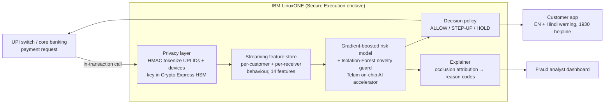

# Kavach: Real-Time UPI Scam Shield on IBM LinuxONE

> **IBM Z Datathon 2026 · Theme 1: Real-Time AI for Critical Decisions**
> (with privacy-by-design from Theme 2: *AI Secured*)

Kavach scores **every UPI payment while it is happening**: in about 13 ms, before the money leaves the account. It then decides one of three actions:

| Decision | What happens | When |
|---|---|---|
| **ALLOW** | Payment goes through untouched | ~99.7% of genuine payments |
| **STEP-UP** | The customer sees a plain-language warning (English + Hindi) and must re-confirm | Medium risk, or a never-seen-before pattern |
| **HOLD** | The payment is paused, the customer is told why and pointed to helpline **1930** | High risk |

Every alert carries **human-readable reasons**, for example *"Customer is on a live phone call while paying"*, *"Receiver got money from 7 different people today (mule pattern)"*. The bank, the customer and a regulator can all see *why* a payment was stopped.

## The problem

India processes **well over 10 billion UPI payments a month**, and fraud has followed the volume. The fastest-growing scams are not hacks. They are **social engineering**:

* **"Digital arrest"**: a fake police, CBI or customs officer keeps the victim (often elderly) on a video call for hours and pressures them into sending their savings to "verify" them.
* **Collect-request scams**: "You won ₹4,999, approve this request to receive it." Approving a COLLECT request *sends* money.
* **SIM-swap / remote-access takeovers**: a new device in another city drains the account in minutes.
* **Money mules**: bought or rented bank accounts collect money from many victims and pass it on within minutes.

Once a UPI payment settles, recovery is slow and often impossible. **The only good time to stop it is during the transaction.** That needs AI sitting right where the transaction is processed, which for most Indian banks is on IBM Z.

## Results (held-out final week, never seen in training)

| Metric | Value |
|---|---|
| Scams caught (STEP-UP or HOLD) | **95.4%** |
| Fraud money intercepted | **98.1%** (₹91.1 L of ₹92.9 L) |
| HOLD precision (a held payment really is fraud) | **95.2%** |
| Genuine payments that see *any* friction | **0.34%** |
| Genuine payments wrongly held | **0.06%** |
| PR-AUC / ROC-AUC | 0.972 / 0.999 |
| End-to-end decision latency (privacy + features + model + explanation) | **p50 13 ms, p99 27 ms** on a laptop CPU |

**Fairness audit:** age is *never* a model input. We use it only to check outcomes:

| Age group | Genuine payments flagged | Scams caught |
|---|---|---|
| 18–35 | 0.28% | 92.7% |
| 36–55 | 0.38% | 96.7% |
| 56+ | 0.34% | 95.7% |

Older customers are protected as well as everyone else and are not over-blocked.

Full numbers: [`artifacts/metrics.json`](artifacts/metrics.json). Regenerate them with `python -m kavach.train`.

## How it works



1. **Privacy layer** ([`kavach/privacy.py`](kavach/privacy.py)): UPI IDs and device IDs are replaced by keyed HMAC-SHA256 tokens *at ingestion*. The feature store, the model and the logs never see a raw identifier. Analysts only see a mask like `us***48@okaxis`.
2. **Streaming feature store** ([`kavach/features.py`](kavach/features.py)): it keeps live behaviour per customer (usual amount, trusted payees, devices and cities, last-hour burst, 24h spend) and per receiver (how many distinct people paid them today, which is the mule signal). A payee, device or city only becomes *trusted* after 24 h, so a scammer can't make themselves look familiar by repeating payments. **Training replays history through exactly the same code that serves live traffic, so there is no train/serve skew.**
3. **Risk model** ([`kavach/train.py`](kavach/train.py)): a `HistGradientBoostingClassifier` for known scam patterns plus an `IsolationForest` trained on genuine traffic only, which raises a STEP-UP for *never-seen-before* behaviour. The data is split by time (train on weeks 1–2, set thresholds on days 18–22, test on the final week) so we always evaluate on the future.
4. **Explainer** ([`kavach/engine.py`](kavach/engine.py)): for each flagged payment we ask "how much does risk drop if this one signal looked normal?" (occlusion attribution in a single batched model call). The top signals become plain-language reasons.
5. **Decision + nudge**: thresholds are tuned for **≥90% HOLD precision** (we rarely block an honest payment) and **~97% STEP-UP recall** (a light-touch warning catches almost everything). The customer message is scam-specific and bilingual.

## Why IBM Z / LinuxONE

| Need | IBM Z capability | In this prototype |
|---|---|---|
| Score *inside* the payment, at UPI scale, without shipping data off-platform | **Telum / Telum II on-chip Integrated Accelerator for AI**; IBM Z Deep Learning Compiler, Snap ML; **Machine Learning for z/OS** for in-transaction scoring next to CICS/IMS | Runs on LinuxONE; single-row scoring path built for in-transaction latency. Next step: Snap ML / ONNX → zDLC on the accelerator |
| Customer identity never exposed | **Crypto Express HSM** (CCA / EP11) for tokenization keys, **pervasive encryption** for data at rest and in flight | HMAC tokenization at ingestion; key comes from env today, HSM-held in production |
| Protect the model and data even from admins | **IBM Secure Execution for Linux** / Hyper Protect confidential containers | Stateless container, ready for a Secure Execution guest |
| Future-proof the crypto | **Quantum-safe** algorithms (ML-KEM / ML-DSA) in Crypto Express and Z firmware | Token keys and service TLS can move to quantum-safe crypto with no model changes |
| 24×7, zero-downtime | Z reliability, scale-up to thousands of TPS per LPAR | Stateless scoring + in-memory state; scale out across LinuxONE cores |

Data gravity is the core argument. Bank transactions **already live on IBM Z**. Moving every payment to an external cloud for scoring adds latency, cost and data-exposure risk. Kavach brings the AI to the data.

## Run it

```bash
pip install -r requirements.txt
python -m kavach.data_gen     # ~140k synthetic UPI transactions (data/)
python -m kavach.train        # trains, evaluates, writes artifacts/
python -m kavach.app          # http://localhost:8000
```

Or with Docker (builds natively on `linux/s390x`): `docker build -t kavach . && docker run -p 8000:8000 kavach`.

On **IBM LinuxONE**, see [`docs/LINUXONE.md`](docs/LINUXONE.md).

### API

```bash
curl -X POST localhost:8000/api/score -H 'Content-Type: application/json' -d '{
  "payer_vpa":"user01063@ybl","payee_vpa":"acct99123@ybl","amount":95000,
  "device_id":"dev-xyz","city":"Mumbai","txn_type":"P2P","on_call":1,"payee_account_age_days":6}'
```

The response contains `decision`, `risk`, `reasons[]` and the bilingual `nudge`, plus `latency_ms`.

## Data & responsible AI

* **Data:** real UPI data is not public, and rightly so. [`kavach/data_gen.py`](kavach/data_gen.py) simulates 30 days of traffic for 4,000 customers, 600 merchants and 80 mule accounts. It injects four fraud patterns modelled on public NPCI / RBI / I4C advisories. Legit traffic deliberately includes **hard negatives**: big rent payments to new payees, payments made while on a call, new shops, travel, new phones. Mules include **old, rented accounts**, so "new account = fraud" does not work. Everything is seeded and reproducible.
* **No demographics in the model.** Age is used only for the fairness audit.
* **Human in the loop:** HOLD pauses the payment rather than cancelling it. The customer or the bank can release it after verification.
* **Explainability by default:** no alert is shown without its reasons.
* **Limitations:** results are on synthetic data. A real deployment needs bank data, drift monitoring and periodic fairness re-audits. On-call status needs consent-based device telemetry from the bank app.

## Repo map

```
kavach/
  data_gen.py   synthetic UPI stream + 4 fraud patterns
  privacy.py    HMAC tokenization + masking
  features.py   streaming feature store (shared by training & serving)
  train.py      time-split training, thresholds, fairness + latency eval
  engine.py     score → explain → decide → nudge
  app.py        Flask API + live stream replay
  static/       analyst dashboard
docs/           architecture, LinuxONE guide, pitch material
```

## Open-source used

Python, NumPy, pandas, scikit-learn, joblib, Flask (all BSD/MIT-style licences). No external datasets.
